# Saud's Flight System

Saud's Flight System is a Java REST API for flight booking, airline administration, maintenance, airport inspections, and FAA-style airplane approval. The idea grew out of an earlier frontend project that used the Amadeus API: this project explores building the backend behind an aviation application. The current backend manages its own PostgreSQL data; it does not integrate with Amadeus.

The purpose is to connect three main users: customers who search and book flights, airline administrators who manage airplanes and schedules, and FAA administrators who review airplane activation requests. Maintenance providers and airport employees also manage maintenance requests and per-flight inspections. It is an educational project, with a wider aviation workflow planned in the ERD.

## Main features

- Customer registration with email verification, account setup, JWT login, password management, and profile updates with optional images.
- Role and ownership checks for customer, airline administrator, and FAA administrator operations; temporary lockout after repeated failed logins.
- Flight search with route, date, airline, and seat-class filters, pagination, and sorting.
- Seat booking and cancellation, seat availability updates, and email confirmations.
- Airline and airline administrator creation, airplane registration, and FAA activation approval or rejection.
- Flight scheduling with airplane availability checks and scheduled flight-status updates.
- Crew assignment creation, listing, and removal, with duty validation, scheduling conflict checks, database locks, and audit logging.
- Maintenance provider setup and airline contracts, maintenance requests, technician assignment, completion, and audit records.
- Airport operator setup, airport employee accounts, and role-based inspector assignment.
- Per-flight inspections with pass/fail results, reinspection history, scoped lists, database locking, and one pending attempt per flight.
- Server-Sent Events (SSE) notifying connected FAA administrators about airplane activation requests.
- Database audit records, centralized error handling, demo data seeding, and Postman collections.
- Interactive Swagger UI and a generated OpenAPI specification.

## Technologies

| Technology | Use |
| --- | --- |
| Java 17 and Spring Boot 4.1.1 | Application runtime and REST backend |
| Spring MVC | Controllers, HTTP requests, and SSE through `SseEmitter` |
| Spring Security, JWT (JJWT), BCrypt | Authentication, authorization, password and security-answer hashing |
| Spring Data JPA / Hibernate and PostgreSQL | Entity relationships, repositories, and persistence |
| Maven and Maven Wrapper | Dependencies, compilation, and running tests |
| Spring Mail / SMTP | Verification and transactional email |
| springdoc-openapi 3.1.1 / Swagger UI | Generated API documentation and interactive requests |
| Lombok | Reducing Java boilerplate |
| Apache Commons Validator, Passay, libphonenumber | Email, password, and phone validation |
| JUnit and Spring Boot Test | Automated testing |
| Postman, Git, and GitHub | Manual API testing, version control, and repository hosting |

## Architecture

The application is a single Spring Boot backend organized into layers:

```text
Swagger UI / Postman / API client
              |
     Spring Security + JWT filter
              |
         Controllers
              |
           Services ----> SMTP email / SSE connections
              |
      JPA repositories
              |
          PostgreSQL
```

| Package | Responsibility |
| --- | --- |
| `controller` | HTTP endpoints for accounts, customers, bookings, flights, airlines, FAA administration, and notifications |
| `service` | Business rules, validation, transactions, email, notifications, and audit logging |
| `repository` | Database access through Spring Data JPA |
| `model` | Persistent entities, request objects, and response DTOs |
| `security` | JWT processing, user details, password encoding, and route access |
| `exception` | Application exceptions and centralized HTTP error responses |
| `config` | Optional database seeding and OpenAPI configuration |

Authentication uses a shared `User` entity linked to the relevant customer, airline employee, FAA administrator, maintenance employee, or airport employee profile. Controllers delegate to services, which enforce business rules and access repositories. Business changes and audit entries share transactions. Scheduled jobs update flight statuses, while SSE keeps an HTTP connection open for server-to-client events. The SSE implementation stores active connections in memory and sends transactional events after a successful commit.

## General approach

I began with the broader aviation system idea and designed the entities around the ERD. The early work focused on airlines, airplanes, airports, flights, bookings, and user profiles. As authentication developed, I changed the model to separate shared login details into a `User` entity linked to the different profile types. This let authentication use one account structure while keeping each role's details in its own model.

I then built the application in stages: registration and email verification, validation and password management, airline and FAA workflows, flight scheduling, and booking. I organized the code into controllers, services, and repositories, keeping the main validation and business rules in services. Later work added flight search, SSE notifications, audit logging, account lockout, tests, and sample data. Because the original plan was larger than the available time, I reduced the scope to complete the booking and airplane-approval workflows before the deadline.

## User stories

See [User stories](docs/USER-STORIES.md) for the current customer, airline administrator, and FAA administrator workflows, plus deferred stories from the wider design. These stories were documented retrospectively from the implementation and original scope.

## ERD

See the [ERD below](#erd-diagram) for the updated maintenance, airport-account, and inspection relationships. The separate [implemented system ERD](docs/ERD-IMPLEMENTED.md) documents all 20 current entities, including these additions and payment mappings.

## Planning

See [Planning and progress](docs/PLANNING.md) for deliverables, scope, a development timeline, and remaining work. This is a retrospective record based on Git history, not a claim that a planning board existed during development.

## API documentation

After starting the application:

These are local development links, not hosted documentation. `localhost` means the computer opening the link, so the backend must be running on that computer at port 8080. If the browser reports a refused connection, start the application using the installation steps below and keep it running. GitHub does not host these pages; another developer must run their own local instance. The YAML endpoint may download a file instead of displaying a page.

- API base URL: `http://localhost:8080`
- [Swagger UI](http://localhost:8080/swagger-ui/index.html)
- [OpenAPI JSON](http://localhost:8080/v3/api-docs)
- [OpenAPI YAML](http://localhost:8080/v3/api-docs.yaml)
- [Detailed endpoint guide](docs/API-GUIDE.md), including request examples, business rules, SSE usage, audit logging, and test setup.
- [Postman presentation guide](postman/PRESENTATION.md) and [sample database reference](SAMPLE-DATABASE.md).

Swagger UI is a browser interface for exploring the API. OpenAPI is the structured specification that powers it. The documentation routes are public; business endpoints retain their authentication and role checks. The integration uses [springdoc-openapi](https://springdoc.org/).

In Swagger UI, expand `POST /auth/users/login`, choose **Try it out**, and log in with a seeded account. Copy the JWT from the response's `message` field. Click **Authorize**, paste just the token (without `Bearer `), and authorize. Swagger then includes the bearer header in protected requests. Use the account role appropriate to the endpoint. Login, registration-email requests, and verification do not require a token. Account setup requires login; other protected endpoints require an active account.

The specification is generated from controller signatures. Some endpoints return generic response types, so the detailed guide remains useful for exact response shapes and business validation. For the long-running SSE stream, use the authenticated `curl.exe -N` example in the guide.

### Payment endpoints

Payment endpoints require an active account and a bearer JWT unless marked public. Only the booking owner can start checkout or check payment status.

| Method | Endpoint | Purpose |
| --- | --- | --- |
| POST | `/payments/bookings/{bookingId}/checkout` | Create or reuse a Stripe sandbox Checkout Session |
| GET | `/payments/bookings/{bookingId}` | Retrieve the session from Stripe, update the stored payment, and return its status |
| GET | `/payments/success` | Public informational page after checkout |
| GET | `/payments/cancel` | Public informational page when leaving checkout |

#### Start checkout

`POST /payments/bookings/{bookingId}/checkout`

No request body is required. The backend selects the price from the booking's flight and seat class.

Example response (`200 OK`):

```json
{
  "paymentId": 1,
  "checkoutUrl": "https://checkout.stripe.com/..."
}
```

Open `checkoutUrl` in a browser to pay. The URL can be `null` when the session is no longer open or the booking/payment is no longer eligible.

Checkout requires an active booking and flight, configured positive pricing, and departure more than five minutes away. Already-paid or expired payments are rejected.

#### Verify payment

`GET /payments/bookings/{bookingId}`

Example response (`200 OK`):

```json
{
  "id": 1,
  "amount": 15000,
  "currency": "USD",
  "status": "PAID"
}
```

Statuses are `PENDING`, `PAID`, and `EXPIRED`. Amounts are integers in the currency's smallest unit; `15000` USD means USD 150.00.

This endpoint contacts Stripe before returning the payment status. Visiting `/payments/success` does not confirm payment, and visiting `/payments/cancel` does not cancel the booking or expire the session.

There is no webhook listener or automatic background reconciliation. After paying, call the payment-status endpoint to update the database. If no session ID was saved, the endpoint asks you to retry checkout.

#### Payment errors

| Status | Meaning |
| --- | --- |
| 400 | Invalid booking/payment state, missing pricing, or unavailable checkout |
| 403 | The logged-in user does not own the booking/payment |
| 404 | Booking or payment not found |
| 409 | Conflicting checkout, payment requiring verification, or cancellation blocked by payment |
| 502 | Stripe API request failed |
| 503 | Stripe connection failure or rate limit |

#### Concurrency and multithreading

Stripe API calls run directly on the request thread. The web server handles multiple requests concurrently, so separate users can run payment workflows at the same time, subject to available threads, database connections, and locks. The shared five-thread `ExecutorService` in `ExecutorConfiguration` remains available for other tasks, but the payment workflow does not use it.

Payment preparation and updates use a pessimistic booking lock. Payments also use optimistic versioning, a unique booking relationship, and Stripe idempotency keys. Stripe network calls run outside the database transactions.

`PaymentServiceTest` keeps its own two-thread executor to simulate simultaneous requests and check duplicate-payment prevention and competing payment updates. These tests verify database concurrency protection, not the removed Stripe task wrapper. They require a configured test database and the fixtures described in `TESTING-NOTES-TEMP.md`. Run them with `./mvnw -Dtest=PaymentServiceTest test` (or `.\mvnw.cmd -Dtest=PaymentServiceTest test` on Windows).

### Crew assignment endpoints

These endpoints require an active account and a bearer JWT belonging to an airline employee with the `ADMIN` airline role. The flight must belong to that admin's airline.

| Method | Endpoint | Result |
| --- | --- | --- |
| POST | `/airlineAdmin/flights/{flightId}/addCrewAssignment` | Assign an employee to a flight; returns `201 Created` |
| GET | `/airlineAdmin/flights/{flightId}/crewAssignments` | List the flight's crew; returns `200 OK` |
| DELETE | `/airlineAdmin/flights/{flightId}/crewAssignments/{employeeId}` | Remove an employee from the flight; returns `204 No Content` |

#### Assign crew

`POST /airlineAdmin/flights/1/addCrewAssignment`

```json
{
  "employeeId": 2,
  "duty": "PILOT"
}
```

Use existing flight and employee IDs. Both request fields are required. The employee must belong to the admin's airline, and the flight must be `PENDING_CREW` or `ACTIVE` with a future scheduled departure.

Allowed duties are `PILOT`, `SECONDARY_PILOT`, and `FLIGHT_ATTENDANT`. Both pilot duties require an employee whose airline role is `PILOT`; attendant duty requires `FLIGHT_ATTENDANT`.

Duplicate assignments and overlapping scheduled flights are rejected. Cancelled flights do not count as conflicts. Back-to-back flights are allowed; no gap between flights is enforced.

Example response:

```json
{
  "id": 1,
  "flightId": 1,
  "employeeId": 2,
  "duty": "PILOT",
  "assignedAt": "2026-10-24T12:00:00"
}
```

#### List crew

`GET /airlineAdmin/flights/1/crewAssignments`

```json
[
  {
    "employeeId": 2,
    "duty": "PILOT",
    "assignedAt": "2026-10-24T12:00:00"
  }
]
```

A flight with no assignments returns `[]`. Listing does not require the flight to be upcoming or active.

#### Remove crew

`DELETE /airlineAdmin/flights/1/crewAssignments/2`

Removes employee `2` from flight `1`. No request body is required. The flight must belong to the admin's airline, be `PENDING_CREW` or `ACTIVE`, and have a future scheduled departure. Removing crew from an active flight must preserve at least one pilot, one secondary pilot, and one flight attendant. A missing assignment returns `404 Not Found`; success returns `204 No Content` with an empty response body.

Validation failures, including airline ownership mismatches and scheduling conflicts, return `400 Bad Request`. An authenticated user without the required admin role receives `403 Forbidden`; missing flights or employees return `404 Not Found`.

Crew listing takes a shared flight read lock; assignment creation and removal take a flight write lock followed by an employee write lock. Transactions hold these locks until completion, allowing concurrent crew readers while making conflicting reads and writes wait. Successful creation, listing, and removal produce Logger messages and database audit records.

There is no assignment-update endpoint. Remove an assignment and add it again to change its duty.

### Maintenance endpoints

FAA admins create providers and their admin accounts. Airline admins contract providers and request maintenance for their own airplanes. Provider admins assign their technicians; only the assigned technician can complete a pending record.

| Method | Endpoint | Purpose |
| --- | --- | --- |
| POST | `/faaadmin/maintenanceProviders` | Create provider; JSON name and contactEmail |
| POST | `/faaadmin/maintenanceProviders/{providerId}/addMaintenanceAdmin` | Create provider admin account |
| POST | `/maintenanceAdmin/technicians` | Create technician within the admin's provider |
| POST | `/airlineAdmin/maintenanceProviders/{providerId}/contract` | Contract provider for the admin's airline |
| POST | `/airlineAdmin/airplanes/{airplaneId}/maintenanceRequests` | Request maintenance; JSON providerId and optional description |
| GET | `/maintenanceAdmin/maintenanceRequests` | List the provider's requests |
| POST | `/maintenanceAdmin/maintenanceRequests/{requestId}?technicianId=...` | Assign a technician |
| GET | `/maintenanceTechnician/maintenanceRecords` | List the technician's assignments |
| PUT | `/maintenanceTechnician/maintenanceRecords/{recordId}/complete?findings=...` | Complete work; findings optional |

A request starts PENDING without a technician. Assignment keeps it PENDING; completion changes it to COMPLETED. Maintenance staff cannot ground or activate airplanes, and completion does not change an inspection result. Cancellation and airline maintenance-history endpoints remain deferred.

Contract linking and request creation lock the provider before checking airline relationships. Assignment locks the maintenance record before the technician; completion locks the record. State checks and audit writes share the transaction. Multiple pending maintenance requests are allowed.

### Airport accounts and inspection endpoints

FAA admins create operators, link airports, and create airport admin accounts. Each airport admin manages one airport, even though the creation endpoint is named addAirportOperatorAdmin. Airport admins can create INSPECTOR or BAGGAGE_HANDLER employees at their own airport; the baggage workflow itself is deferred.

| Method | Endpoint | Purpose / caller |
| --- | --- | --- |
| POST | `/faaadmin/airportOperators` | FAA admin; JSON name and contactEmail |
| PUT | `/faaadmin/airports/{airportId}/operator?operatorId=...` | FAA admin links an operator |
| POST | `/faaadmin/airports/{airportId}/addAirportOperatorAdmin` | FAA admin creates an airport admin |
| POST | `/airportAdmin/employees?role=INSPECTOR` | Airport admin creates staff; also accepts BAGGAGE_HANDLER |
| POST | `/airportAdmin/flights/{flightId}/inspection?inspectorId=...` | Origin-airport admin assigns an inspector |
| GET | `/airportAdmin/inspections` | Admin lists inspections at their airport |
| GET | `/airportInspector/inspections` | Inspector lists their assignments |
| PUT | `/airportInspector/flights/{flightId}/inspections/{inspectionId}/complete?result=PASSED&reason=...` | Assigned inspector records PASSED or FAILED; reason optional |
| POST | `/airlineAdmin/flights/{flightId}/reinspection` | Owning airline admin requests another attempt after failure |
| GET | `/airlineAdmin/flights/{flightId}/inspections` | Owning airline admin lists the flight's inspection history |

Employee creation uses AddAirportEmployeeRequest JSON: fName, lName, cpr, emailAddress, phoneNumberOpeningCode, phoneNumber, password, securityQuestion, and securityQuestionAnswer. Airport/operator relationships are derived by the service. Airport linking and employee creation lock the airport before checking its operator. An airport with employees cannot change operators; attempting to link its current operator again is also rejected.

#### Inspection workflow

1. The origin-airport admin selects an INSPECTOR at the same airport and operator. The first assignment creates a PENDING inspection.
2. Only the assigned inspector can complete the latest attempt as PASSED or FAILED. The optional reason is stored as supplied, with a 2000-character limit, and completedAt is recorded.
3. After failure, the owning airline admin can request reinspection. This creates a new unassigned PENDING attempt while preserving the previous result and reason.
4. The airport admin assigns an inspector to the new attempt; it need not be the previous inspector.

Assignment cannot overwrite an assigned inspector or reopen a completed attempt. Reinspection is rejected if the latest attempt is pending or passed. Mutations require a flight in PENDING_CREW or ACTIVE status. There is no cross-flight defect carryover, and airport employees do not read maintenance records.

Lists return FlightInspectionResponse objects with id, flightId, airportId, nullable inspectorId, status, reason, createdAt, and completedAt, ordered by descending ID. A flight with no inspections returns an empty list.

#### Inspection concurrency and departure limits

Assignment, completion, and reinspection first lock the flight through findByIdForUpdate(), then read/check the latest attempt. This serializes competing requests, including the first assignment when no inspection row exists. Audit writes share the transaction; listing methods use ordinary reads. The PostgreSQL partial unique index flight_inspections_one_pending_per_flight additionally rejects two PENDING attempts for one flight while allowing completed history.

Inspection completion never changes FAA airplane status. Pilot take-off and departure enforcement are deferred: the existing scheduler still transitions ACTIVE to IN_AIR based on actualDeparture without checking inspection results. The future pilot workflow must coordinate the same flight lock, assigned-pilot authorization, crew readiness, a passed latest inspection, and independent FAA airplane status before departure.

### Changed existing endpoints

#### Create a flight

`POST /airlineAdmin/airplanes/{airplaneId}/addFlight`

Airline administrators must now supply positive `firstClassPrice` and `standardPrice` values. Currency accepts `BHD` or `USD`; omitting it defaults to `BHD`, while explicit `null` is rejected.

```json
{
  "scheduledDeparture": "2027-01-15T10:00:00",
  "scheduledArrival": "2027-01-15T12:00:00",
  "originAirportIataCode": "BAH",
  "arrivalAirportIataCode": "DXB",
  "firstClassPrice": 30000,
  "standardPrice": 15000,
  "currency": "USD"
}
```

Use future dates and existing airport codes. Existing or seeded flights without prices cannot be paid for until valid pricing is configured.

#### Cancel a booking

`DELETE /bookings/{bookingId}`

Existing ownership, airline-admin permissions, and cancellation-time rules remain. Cancellation now locks the booking and returns `409 Conflict` when its payment is:

- `PENDING`: checkout must expire and the stored status must be refreshed before cancellation.
- `PAID`: a refund is required before cancellation; refunds are not implemented.

Bookings without a payment, or with an `EXPIRED` payment, continue through the existing cancellation rules.

## Installation

### 1. Prerequisites and clone

Install JDK 17 or later, PostgreSQL, and Git. A Maven wrapper is included; an installed Maven 3.6.3 or later is an alternative. Use an SMTP account for features that send email.

```powershell
git clone https://github.com/Saud-GA-JDB/PROJECT2_Flight_System.git
cd PROJECT2_Flight_System
```

The following commands use PowerShell. On macOS/Linux, use `./mvnw` and `export NAME=value` for environment variables.

### 2. Configure PostgreSQL

Start PostgreSQL and connect through pgAdmin or `psql` using an account allowed to create databases:

```sql
CREATE DATABASE aviation;
```

The application database user must be able to create and update tables in this database. Hibernate uses `ddl-auto=update` to create/update the schema on startup. Hibernate does not update existing enum check constraints automatically. The old docs/sql/crew-assignment-audit.sql predates maintenance and inspections; do not rerun it unchanged because it omits newer audit values. The development database audit checks were expanded through SQL supplied in chat, not a saved migration. Keep all existing values when adding the airport and inspection actions/entity types from AuditLog.java; user-role checks must include AIRPORT_EMPLOYEE and MAINTENANCE_EMPLOYEE.


After Hibernate has created flight_inspections, the database must also have the partial unique index below. It was confirmed in the development database; do not recreate it there. A fresh database needs it explicitly because the JPA model does not declare this partial index.

```sql
CREATE UNIQUE INDEX flight_inspections_one_pending_per_flight
ON public.flight_inspections (flight_id)
WHERE status = 'PENDING';
```
### 3. Configure the application

For a fresh clone, copy the checked-in template:

```powershell
Copy-Item src/main/resources/application-example.properties src/main/resources/application.properties
```

If you already have a local `application.properties`, keep it and compare it with the template instead of overwriting it. The local file is ignored by Git. The template contains placeholders rather than account credentials.

### 4. Set environment variables

Set these in the same terminal where you start the application. Replace the placeholder values with your own:

```powershell
$env:SPRING_DATASOURCE_URL = "jdbc:postgresql://localhost:5432/aviation"
$env:SPRING_DATASOURCE_USERNAME = "postgres"
$env:SPRING_DATASOURCE_PASSWORD = "YOUR_DATABASE_PASSWORD"
$env:SPRING_MAIL_HOST = "smtp.gmail.com"
$env:SPRING_MAIL_PORT = "587"
$env:SPRING_MAIL_USERNAME = "YOUR_SMTP_USERNAME"
$env:SPRING_MAIL_PASSWORD = "YOUR_SMTP_PASSWORD_OR_APP_PASSWORD"
$env:JWT_EXPIRATION_MS = "86400000"
$env:STRIPE_SECRET_KEY = "YOUR_STRIPE_SANDBOX_SECRET_KEY"
$env:STRIPE_SUCCESS_URL = "http://localhost:8080/payments/success"
$env:STRIPE_CANCEL_URL = "http://localhost:8080/payments/cancel"

# Generate a Base64-encoded 32-byte signing key for local development.
$jwtKeyBytes = New-Object byte[] 32
$jwtRandom = [System.Security.Cryptography.RandomNumberGenerator]::Create()
$jwtRandom.GetBytes($jwtKeyBytes)
$jwtRandom.Dispose()
$env:JWT_SECRET = [Convert]::ToBase64String($jwtKeyBytes)
```

Keep the same JWT secret across restarts if existing tokens should remain valid. Gmail SMTP requires an appropriate app password; use your provider's settings if using another SMTP service. The app does not automatically load a `.env` file. When launching through an IDE, configure these variables in its run configuration.

Use a Stripe sandbox secret key beginning with `sk_test_` or `rk_test_`. When launching through an IDE, set these variables in its run configuration. Stripe CLI and `STRIPE_WEBHOOK_SECRET` are not required.

### 5. Seed the database and start

```powershell
$env:APP_SEED_ENABLED = "true"
.\mvnw.cmd spring-boot:run
```

If the wrapper cannot start, use `mvn spring-boot:run` with installed Maven. The first run downloads dependencies and needs internet access.

Wait for the application to start and report `Database seed completed; existing records were preserved.` The seeder creates seven demo accounts, two airlines, three airports, five airplanes, five flights, four bookings, and an airplane activation request in an empty database. Seeding itself sends no email.

After the first successful seed, stop with **Ctrl+C** and start normally:

```powershell
$env:APP_SEED_ENABLED = "false"
.\mvnw.cmd spring-boot:run
```

Seeding is optional and disabled by default. Rerunning it adds missing data but does not reset existing records or refresh old flight dates. Sample departures start three days after the initial seed. See [Sample database reference](SAMPLE-DATABASE.md) for details; generated IDs may differ between databases.

### 6. Access the API and Swagger

Open [Swagger UI](http://localhost:8080/swagger-ui/index.html), then use one of these local demo accounts:

| Role | Email | Password |
| --- | --- | --- |
| Customer | flighttest.customer@mailsac.com | TestPassword1 |
| Airline administrator | flighttest.airline@mailsac.com | TestPassword1 |
| FAA administrator | flighttest.faa@mailsac.com | TestPassword1 |

These are demonstration credentials. To log in directly from PowerShell:

```powershell
$body = @{ email = "flighttest.customer@mailsac.com"; password = "TestPassword1" } | ConvertTo-Json
$login = Invoke-RestMethod -Method Post -Uri "http://localhost:8080/auth/users/login" -ContentType "application/json" -Body $body
$headers = @{ Authorization = "Bearer $($login.message)" }
Invoke-RestMethod -Uri "http://localhost:8080/flights/search" -Headers $headers
```

Use the same token in Swagger's **Authorize** dialog. Raw documentation is available at [OpenAPI JSON](http://localhost:8080/v3/api-docs). The project is an API backend; it does not include a customer-facing frontend.

### Testing

Some older service tests depend on seeded PostgreSQL fixtures, and some send real email. Use a dedicated seeded test database and working SMTP settings. Follow the [test setup and fixture notes](docs/API-GUIDE.md#database-seeding) before running the service suite. Manual changes to fixtures can affect results.


FlightInspectionServiceTest passed against local PostgreSQL on 28 October 2026: **16 tests, 0 failures, 0 errors, 0 skipped**. It covers failure/reinspection/pass history, unchanged FAA airplane status, audit counts, role/airport/airline/assigned-inspector permissions, scoped lists, rejected reinspection after pending/passed results, competing assignments/completions/reinspection requests, and direct duplicate-pending rejection by the database index.

These tests create their own fixtures, disable seeding, and validate the schema. Ordinary tests roll back; concurrency tests commit and clean up their fixtures. Two worker threads and bounded waits exercise simultaneous requests, and pg_blocking_pids confirms the second request actually waits on a PostgreSQL lock. No pre-existing flight is needed.

```powershell
.\mvnw.cmd -Dtest=FlightInspectionServiceTest test
```

MaintenanceRecordServiceTest separately passed five PostgreSQL integration tests on 27 October 2026. These results cover the tested services, not application-wide concurrency safety, HTTP routing, or the airport-account setup workflow. Departure-versus-inspection tests remain deferred with the pilot workflow.
## Unsolved problems and current limitations

- The full aviation workflow is unfinished. Maintenance, airport accounts, crew coverage checks, and flight inspections are implemented. Baggage handling, pilot take-off/departure enforcement, and air traffic control remain deferred or outside scope.
- Cross-table CPR uniqueness remains a pre-check and is not guaranteed under simultaneous registration/profile changes.
- SSE is live delivery within one backend instance. It has no persistent inbox, missed-event replay, or shared delivery across servers. Clients must reconnect and fetch outstanding requests.
- Flight times use local date-times without offsets, and time-based checks use server-local time. Full airport time-zone handling remains future work.
- A failed verification email can leave a pending registration until expiry. Email and database transactions are not fully coordinated: a delivered email cannot be rolled back if a later database commit fails.


## Major challenges

**Time management and scope.** The original ERD described a much larger system than I could implement in the available time. I narrowed the delivery to customer booking, airline administration, and FAA airplane approvals. This made it possible to finish the core workflows, but the wider operational system remains unfinished.

**Learning SSE.** SSE was especially difficult because we had not been taught how to implement it, and I did not have enough time for a deep dive. The online examples I found were not very helpful for understanding and applying the concept. The implementation now uses Spring MVC's `SseEmitter`, tracks authenticated connections, removes disconnected clients, sends heartbeats, and delivers airplane-request events to connected FAA administrators after the database transaction commits. This provided a working notification path within the project's limited scope.

**Structuring authentication across roles.** During development, I changed the database design so authentication could use a shared `User` entity, with separate links to customer, airline employee, and FAA administrator profiles. This separated common login information from role-specific details and supported the different application workflows.

## Future improvements

Maintenance providers/records, airport operators/employees, crew coverage checks, and per-flight inspections are implemented. Pilot take-off and inspection/FAA departure enforcement are deferred to a future pilot workflow. Baggage handling is also deferred; ATC and navigation remain outside the current scope.

Further improvements include a frontend, reliable notification storage and delivery, consistent response DTOs and validation, a reset-token password recovery flow, time-zone-aware scheduling, schema migrations, and tests that run independently of manually seeded data and external email services.

## AI usage

I used AI during the project for code generation, documentation, discussion, and review:

- **Database seeding:** The database seeding implementation was generated by AI.
- **Postman:** The contents of the `postman/` folder were generated by AI.
- **README:** This `README.md` was generated by AI using the project code, Git history, assignment requirements, and my answers about the project.
- **Unit tests:** The unit tests were created by AI.
- **Audit and logging:** I started the audit and logging implementation manually, including the models and services, and applied it to a few operations. I then asked AI to complete the repetitive work by following my existing approach and patterns.
- **Filtering queries:** The custom `@Query` queries used for filtering were generated by AI.
- **SSE:** I implemented Server-Sent Events manually with AI assistance and guidance from [Baeldung](https://www.baeldung.com/spring-server-sent-events), [Alexander Obregon's tutorial on Medium](https://medium.com/@AlexanderObregon/how-to-implement-server-sent-events-sse-in-spring-boot-620024272ccb), and [GeeksforGeeks](https://www.geeksforgeeks.org/advance-java/server-sent-events-in-spring/).
- **Exploring solutions:** I discussed some problems with AI to explore possible approaches and options.
- **Logic review:** I also used AI to check whether the logic was correct. For those reviews, I asked it to identify issues without editing the logic.

## Resources and acknowledgements

- [Baeldung: email validation in Java](https://www.baeldung.com/java-email-validation-regex)
- [GeeksforGeeks: sending email through Spring Boot SMTP](https://www.geeksforgeeks.org/springboot/spring-boot-sending-email-via-smtp/)
- [Stack Overflow: phone-number validation in Spring Boot](https://stackoverflow.com/questions/71654287/how-to-validate-phone-number-using-spring-boot)
- [springdoc-openapi documentation](https://springdoc.org/)
- ChatGPT assistance included the nine-digit CPR validation expression used in `PendingRegistrationService`.

---

ERD Diagram
---
Implemented entities below follow the current JPA models. `Person` is a mapped superclass, so its fields appear in `CUSTOMER`, `AIRLINE_EMPLOYEE`, `FAA_ADMIN`, `MAINTENANCE_EMPLOYEE`, and `AIRPORT_EMPLOYEE`; it has no separate table. Attribute names use Java field names, with relationship IDs representing join columns. Enum attributes show Java types (not database storage types).

Entities marked `PLANNED` and their relationships are retained from the original design and are not implemented yet. Airport operators/employees, maintenance, crew assignments, and FlightInspection are implemented. FlightInspection replaces the earlier proposed generic GroundServiceAssignment for the current inspection-only scope. For implemented relationships, an optional parent (`o|`) reflects a nullable join column in the current model.

```mermaid
erDiagram
AIRLINE {
long id PK
string name UK
string airlineCode UK
string headquartersCountry
}

    AIRPLANE {
        long id PK
        long airlineId FK
        string registrationNumber UK
        string model
        int seatCapacity
        long maxMileage
        Status status "ACTIVE or GROUNDED; default GROUNDED"
    }

    AIRPLANE_REQUEST {
        long id PK
        long airplaneId FK "Required"
        ApprovalStatus status "PENDING, ACCEPTED, DENIED; default PENDING"
        string reviewReason "Up to 500 characters"
        datetime requestedAt "Creation timestamp"
        datetime reviewedAt
        long reviewedById FK "Nullable FAA admin reviewer"
    }

    FAA_ADMIN {
        long id PK
        string fName
        string lName
        string cpr UK "Required"
        string phoneNumberOpeningCode
        string phoneNumber
        byte[] imageData
        string imageUrl
        datetime createdAt
        datetime updatedAt
    }

    USER {
        long id PK
        string emailAddress UK "Required"
        string password "Required"
        string securityQuestion
        string securityQuestionAnswer
        Role role "CUSTOMER, AIRPORT_EMPLOYEE, AIRLINE_EMPLOYEE, FAA_ADMIN, MAINTENANCE_EMPLOYEE"
        boolean isActive
        Status status "SETUP_REQUIRED, ACTIVE, DEACTIVATED"
        long customerId FK, UK "Nullable"
        long airlineEmployeeId FK, UK "Nullable"
        long faaAdminId FK, UK "Nullable"
        long airportEmployeeId FK, UK "Nullable"
        long maintenanceEmployeeId FK, UK "Nullable"
    }

    PENDING_REGISTRATION {
        long id PK
        string emailAddress UK "Required"
        string cpr UK "Required"
        string codeHash "Required"
        datetime expiresAt "Required"
        int failedAttempts "Required"
        boolean verified "Required"
    }

    AIRLINE_EMPLOYEE {
        long id PK
        long airlineId FK
        string fName
        string lName
        string cpr UK "Required"
        string phoneNumberOpeningCode
        string phoneNumber
        byte[] imageData
        string imageUrl
        datetime createdAt
        datetime updatedAt
        AirlineRole airlineRole "PILOT, FLIGHT_ATTENDANT, GATE_RECEPTION, ADMIN"
        datetime hireDate
        long salary
    }

    AIRPORT_OPERATOR {
        long id PK
        string name "Required"
        string contactEmail "Required"
    }

    AIRPORT {
        long id PK
        long operatorId FK "Nullable"
        string iataCode UK
        string name
        string city
        string country
        string timeZone
    }

    AIRPORT_EMPLOYEE {
        long id PK
        long operatorId FK "Required"
        long airportId FK "Required"
        string fName
        string lName
        string cpr UK "Required"
        string phoneNumberOpeningCode
        string phoneNumber
        byte[] imageData
        string imageUrl
        datetime createdAt
        datetime updatedAt
        AirportRole airportRole "ADMIN, INSPECTOR, BAGGAGE_HANDLER"
    }

    FLIGHT {
        long id PK
        long airlineId FK
        long airplaneId FK
        long originAirportId FK
        long destinationAirportId FK
        string flightNumber
        datetime scheduledDeparture
        datetime scheduledArrival
        datetime actualDeparture
        datetime actualArrival
        string status
    }

    CUSTOMER {
        long id PK
        string fName
        string lName
        string cpr UK "Required"
        string phoneNumberOpeningCode
        string phoneNumber
        byte[] imageData
        string imageUrl
        datetime createdAt
        datetime updatedAt
    }

    BOOKING {
        long id PK
        long customerId FK
        long flightId FK
        string bookingRef UK
        string seatNumber
        datetime bookedAt
        datetime updatedAt
        string status
    }

    CREW_ASSIGNMENT {
        long id PK
        long flightId FK
        long airlineEmployeeId FK
        Duty duty "PILOT, SECONDARY_PILOT, FLIGHT_ATTENDANT"
        datetime assignedAt
    }

    FLIGHT_INSPECTION {
        long id PK
        long flightId FK "Required"
        long airportId FK "Required"
        long inspectorId FK "Nullable"
        InspectionStatus status "PENDING, PASSED, FAILED; required"
        string reason "Optional; up to 2000 characters"
        datetime createdAt "Required"
        datetime completedAt "Nullable"
    }

    MAINTENANCE_PROVIDER {
        long id PK
        string name "Required"
        string contactEmail "Required"
    }

    MAINTENANCE_EMPLOYEE {
        long id PK
        long providerId FK "Required"
        string fName
        string lName
        string cpr UK "Required"
        string phoneNumberOpeningCode
        string phoneNumber
        byte[] imageData
        string imageUrl
        datetime createdAt
        datetime updatedAt
        MaintenanceRole maintenanceRole "ADMIN, TECHNICIAN"
        string licenseNumber "Required by service for technicians"
    }

    MAINTENANCE_RECORD {
        long id PK
        long airplaneId FK "Required"
        long providerId FK "Required"
        long technicianId FK "Nullable"
        string description "Optional; up to 2000 characters"
        string findings "Optional; up to 2000 characters"
        MaintenanceStatus status "PENDING, COMPLETED, CANCELLED; required"
        datetime createdAt "Required"
        datetime updatedAt "Required"
        datetime completedAt "Nullable"
    }

    AIR_NAVIGATION_SERVICE_PROVIDER["AIR_NAVIGATION_SERVICE_PROVIDER (PLANNED)"] {
        long id PK
        string name
        string providerType
    }

    CONTROL_FACILITY["CONTROL_FACILITY (PLANNED)"] {
        long id PK
        long providerId FK
        long airportId FK
        string name
        string facilityType
    }

    ATC_EMPLOYEE["ATC_EMPLOYEE (PLANNED)"] {
        long id PK
        long facilityId FK
        string firstName
        string lastName
        string role
        string employeeNumber UK
    }

    FLIGHT_CONTROL_EVENT["FLIGHT_CONTROL_EVENT (PLANNED)"] {
        long id PK
        long flightId FK
        long controllerId FK
        string eventType
        datetime occurredAt
        string notes
    }

    AIRLINE ||--o{ AIRPLANE : manages
    AIRLINE o|--o{ AIRLINE_EMPLOYEE : employs
    AIRLINE o|--o{ FLIGHT : operates
    AIRPLANE o|--o{ FLIGHT : assignedTo
    AIRPLANE ||--o{ AIRPLANE_REQUEST : has
    FAA_ADMIN o|--o{ AIRPLANE_REQUEST : reviews

    CUSTOMER o|--o| USER : linkedTo
    AIRLINE_EMPLOYEE o|--o| USER : linkedTo
    FAA_ADMIN o|--o| USER : linkedTo
    AIRPORT_EMPLOYEE o|--o| USER : linkedTo
    MAINTENANCE_EMPLOYEE o|--o| USER : linkedTo

    AIRPORT_OPERATOR o|--o{ AIRPORT : operates
    AIRPORT_OPERATOR ||--o{ AIRPORT_EMPLOYEE : employs
    AIRPORT ||--o{ AIRPORT_EMPLOYEE : workplace
    AIRPORT o|--o{ FLIGHT : origin
    AIRPORT o|--o{ FLIGHT : destination

    CUSTOMER o|--o{ BOOKING : makes
    FLIGHT o|--o{ BOOKING : has

    AIRLINE_EMPLOYEE o|--o{ CREW_ASSIGNMENT : receives
    FLIGHT o|--o{ CREW_ASSIGNMENT : has

    AIRPORT_EMPLOYEE o|--o{ FLIGHT_INSPECTION : performs
    AIRPORT ||--o{ FLIGHT_INSPECTION : location
    FLIGHT ||--o{ FLIGHT_INSPECTION : receives

    MAINTENANCE_PROVIDER ||--o{ MAINTENANCE_EMPLOYEE : employs
    MAINTENANCE_EMPLOYEE o|--o{ MAINTENANCE_RECORD : performs
    AIRPLANE ||--o{ MAINTENANCE_RECORD : has
    MAINTENANCE_PROVIDER ||--o{ MAINTENANCE_RECORD : receives
    AIRLINE }o--o{ MAINTENANCE_PROVIDER : contracts

    AIR_NAVIGATION_SERVICE_PROVIDER ||--o{ CONTROL_FACILITY : operates
    AIRPORT o|--o{ CONTROL_FACILITY : hosts
    CONTROL_FACILITY ||--o{ ATC_EMPLOYEE : employs
    ATC_EMPLOYEE ||--o{ FLIGHT_CONTROL_EVENT : handles
    FLIGHT ||--o{ FLIGHT_CONTROL_EVENT : has
```


## Project 3 - Concurrency:
- Trello Link: `https://trello.com/b/b63eU4qX/project-3-concurrency`
- [Database locks, their purpose, and acquisition order](docs/database-locking.md).


## Planning:
- Day 1: Planning, adding the new models from the erd to data models. Read more on concurrency API such as Future etc...
- Day 2: Adding Stripe payments and tests for payment race conditions. Removed unnecessary multithreading and started the crew assignment model.
- Day 3: Adding the crew assignment service and endpoint. Locking employee rows to prevent conflicting assignments.
- Day 4: Adding crew assignment logic, listing, audit logging, and tests for concurrency locking.
- Day 5: Adding crew removal, asynchronous emails, and retrying failed emails every 3 hours. Checking crew coverage before activating flights.
- Day 6: Adding maintenance models, provider contracts, admin accounts, and technicians.
- Day 7: Adding maintenance requests, technician assignment, completion, and tests. Adding airport accounts, flight inspections, and reinspection requests.
- Day 8: Completing inspection lists and tests. Adding more SSE notifications, database locks, concurrency tests, and documentation.


## Resources
- https://docs.oracle.com/javase/8/docs/api/java/util/concurrent/Future.html
- https://www.baeldung.com/java-stripe-api
- https://github.com/stripe/stripe-java
- https://docs.stripe.com/api?lang=java

# AI Usage
- Discussed where I can implement concurrency.
- StripeCheckoutService is fully AI generated
- Stripe Exception handling in the global exception handler
- handleDataIntegrity in the global exception handler
- OpenApiConfiguration.java is AI generated
