# Implemented system ERD

This diagram documents the 24 current JPA entities as of 8 November 2026. The [original ERD](../README.md#erd-diagram) is preserved separately, including its wider planned scope.

Names and types below follow Java fields, rather than PostgreSQL column spelling or SQL types. Relationship attributes use the Java relationship name followed by `Id` to represent their join columns. `PK`, `FK`, and `UK` mean primary, foreign, and unique keys. `Required` marks explicit non-null mappings; other attributes have no explicit non-null constraint in the model. Relationship cardinalities reflect JPA nullability, which can be less strict than service validation.

```mermaid
erDiagram
    AIR_NAVIGATION_SERVICE_PROVIDER {
        Long id PK
        String name "Required, 150 characters"
        String contactEmail "Required, 254 characters"
    }
    CONTROL_FACILITY {
        Long id PK
        Long providerId FK "Required"
        Long airportId FK,UK "Required"
        String name "Required, 150 characters"
        FacilityType facilityType "TOWER"
    }
    ATC_EMPLOYEE {
        Long id PK
        String cpr UK "Required, inherited from Person"
        String fName
        String lName
        String phoneNumberOpeningCode
        String phoneNumber
        byte[] imageData
        String imageUrl
        LocalDateTime createdAt
        LocalDateTime updatedAt
        String employeeNumber UK "Required, normalized uppercase"
        ATCRole atcRole "ADMIN or CONTROLLER"
        Long facilityId FK "Required"
    }
    AIR_NAVIGATION_SERVICE_PROVIDER ||--o{ CONTROL_FACILITY : operates
    AIRPORT ||--o| CONTROL_FACILITY : hosts
    CONTROL_FACILITY ||--o{ ATC_EMPLOYEE : employs
    ATC_EMPLOYEE o|--o| USER : profile
    AIRLINE {
        Long id PK
        String name UK
        String airlineCode UK
        String headquartersCountry
    }

    AIRPLANE {
        Long id PK
        String registrationNumber UK
        String model
        int firstClassSeatsCapacity
        int standardSeatsCapacity
        Long maxMileage
        LocalDateTime addedAt
        Status status "Required; ACTIVE or GROUNDED"
        Long airlineId FK "Required"
    }

    AIRPORT {
        Long id PK
        String iataCode UK
        String name
        String city
        String country
        String timeZone
        Long operatorId FK "Nullable"
    }

    FLIGHT_CONTROL_EVENT {
        Long id PK
        Long flightId FK "Required"
        Long facilityId FK "Required"
        Long actorUserId FK "Required"
        FlightOperation operation "DEPARTURE or ARRIVAL"
        EventType eventType "REQUESTED, APPROVED, REJECTED, WITHDRAWN, REVOKED, TAKE_OFF, LANDED"
        long cycle "Required"
        long revision "Unique with flightId"
        Instant occurredAt "UTC"
        String reason "Nullable, maximum 2000"
    }
    FLIGHT ||--o{ FLIGHT_CONTROL_EVENT : records
    CONTROL_FACILITY ||--o{ FLIGHT_CONTROL_EVENT : responsibleTower
    USER ||--o{ FLIGHT_CONTROL_EVENT : performs
    CONTROL_FACILITY o|--o{ FLIGHT : currentClearanceTower

    FLIGHT {
        Long id PK
        String flightNumber
        int firstClassSeatsCount
        int standardSeatsCount
        LocalDateTime scheduledDeparture
        LocalDateTime scheduledArrival
        LocalDateTime actualDeparture
        LocalDateTime actualArrival
        FlightStatus status "PENDING_CREW, ACTIVE, IN_AIR, CLOSED, CANCELLED"
        FlightOperation clearanceOperation "Nullable"
        ClearanceStatus clearanceStatus "Required, default NONE; EXPIRED is computed only"
        Long clearanceFacilityId FK "Nullable before first cycle"
        long clearanceCycle "Required, default 0"
        long clearanceRevision "Required, default 0"
        Instant clearanceApprovedAt "Nullable UTC"
        Instant clearanceExpiresAt "Nullable UTC"
        Long firstClassPrice
        Long standardPrice
        Currency currency "BHD or USD"
        Long airlineId FK
        Long airplaneId FK
        Long originAirportId FK
        Long destinationAirportId FK
    }

    BOOKING {
        Long id PK
        LocalDateTime bookedAt
        LocalDateTime updatedAt
        String bookingRef UK
        String seatNumber
        BookingStatus status "BOOKED, CANCELLED, FINISHED"
        Long userId FK
        Long flightId FK
    }

    USER {
        Long id PK
        String emailAddress UK "Required"
        String password "Required; hash"
        String securityQuestion
        String securityQuestionAnswer "Hash"
        Role role "CUSTOMER, AIRPORT_EMPLOYEE, AIRLINE_EMPLOYEE, FAA_ADMIN, MAINTENANCE_EMPLOYEE, ATC_EMPLOYEE"
        boolean isActive
        Status status "SETUP_REQUIRED, ACTIVE, DEACTIVATED"
        int failedLoginAttempts "Required; default 0"
        LocalDate loginAttemptsDate
        Long customerId FK, UK
        Long airlineEmployeeId FK, UK
        Long faaAdminId FK, UK
        Long airportEmployeeId FK, UK
        Long atcEmployeeId FK, UK
        Long maintenanceEmployeeId FK, UK
    }

    CUSTOMER {
        Long id PK
        String fName
        String lName
        String cpr UK "Required"
        String phoneNumberOpeningCode
        String phoneNumber
        byte[] imageData
        String imageUrl
        LocalDateTime createdAt
        LocalDateTime updatedAt
    }

    AIRLINE_EMPLOYEE {
        Long id PK
        String fName
        String lName
        String cpr UK "Required"
        String phoneNumberOpeningCode
        String phoneNumber
        byte[] imageData
        String imageUrl
        LocalDateTime createdAt
        LocalDateTime updatedAt
        AirlineRole airlineRole "PILOT, FLIGHT_ATTENDANT, GATE_RECEPTION, ADMIN"
        LocalDate hireDate
        Long salary
        Long airlineId FK
    }

    FAA_ADMIN {
        Long id PK
        String fName
        String lName
        String cpr UK "Required"
        String phoneNumberOpeningCode
        String phoneNumber
        byte[] imageData
        String imageUrl
        LocalDateTime createdAt
        LocalDateTime updatedAt
    }

    AIRPLANE_REQUEST {
        Long id PK
        Long airplaneId FK "Required"
        ApprovalStatus status "Required; PENDING, ACCEPTED, DENIED"
        String reviewReason "Up to 500 characters"
        LocalDateTime requestedAt
        LocalDateTime reviewedAt
        Long requestedById FK
        Long reviewedById FK
    }

    PENDING_REGISTRATION {
        Long id PK
        String emailAddress UK "Required"
        String cpr UK "Required"
        String codeHash "Required"
        LocalDateTime expiresAt "Required"
        int failedAttempts "Required"
        boolean verified "Required"
    }

    AUDIT_LOG {
        Long id PK
        LocalDateTime createdAt "Required; UTC; not updatable"
        Long userId "Scalar actor ID; not a foreign key"
        Role userRole
        Action action "Required; audit action enum"
        EntityType entityType "Required; see AuditLog.EntityType"
        Long entityId "Required; scalar target ID; not a foreign key"
        String description "Required; up to 500 characters"
    }

    AIRPORT_OPERATOR {
        long id PK
        string name "Required"
        string contactEmail "Required"
    }

    AIRPORT_EMPLOYEE {
        long id PK
        long operatorId FK "Required"
        long airportId FK "Required"
        string fName
        string lName
        string cpr UK "Required"
        string phoneNumberOpeningCode
        string phoneNumber
        byte[] imageData
        string imageUrl
        datetime createdAt
        datetime updatedAt
        AirportRole airportRole "ADMIN, INSPECTOR, BAGGAGE_HANDLER"
    }

    CREW_ASSIGNMENT {
        long id PK
        long flightId FK
        long airlineEmployeeId FK
        Duty duty "PILOT, SECONDARY_PILOT, FLIGHT_ATTENDANT"
        datetime assignedAt
    }

    FLIGHT_INSPECTION {
        long id PK
        long flightId FK "Required"
        long airportId FK "Required"
        long inspectorId FK "Nullable"
        InspectionStatus status "PENDING, PASSED, FAILED; required"
        string reason "Optional; up to 2000 characters"
        datetime createdAt "Required"
        datetime completedAt "Nullable"
    }

    MAINTENANCE_PROVIDER {
        long id PK
        string name "Required"
        string contactEmail "Required"
    }

    MAINTENANCE_EMPLOYEE {
        long id PK
        long providerId FK "Required"
        string fName
        string lName
        string cpr UK "Required"
        string phoneNumberOpeningCode
        string phoneNumber
        byte[] imageData
        string imageUrl
        datetime createdAt
        datetime updatedAt
        MaintenanceRole maintenanceRole "ADMIN, TECHNICIAN"
        string licenseNumber "Required by service for technicians"
    }

    MAINTENANCE_RECORD {
        long id PK
        long airplaneId FK "Required"
        long providerId FK "Required"
        long technicianId FK "Nullable"
        string description "Optional; up to 2000 characters"
        string findings "Optional; up to 2000 characters"
        MaintenanceStatus status "PENDING, COMPLETED, CANCELLED; required"
        datetime createdAt "Required"
        datetime updatedAt "Required"
        datetime completedAt "Nullable"
    }

    PAYMENT {
        Long id PK
        Long bookingId FK, UK "Required"
        Long amount "Required; smallest currency unit"
        Currency currency "Required; BHD or USD"
        String stripeCheckoutSessionId UK
        String stripePaymentIntentId UK
        PaymentStatus status "Required; PENDING, PAID, EXPIRED"
        Long version "Optimistic lock"
        LocalDateTime createdAt
        LocalDateTime updatedAt
    }

    AIRLINE ||--o{ AIRPLANE : manages
    AIRLINE o|--o{ AIRLINE_EMPLOYEE : employs
    AIRLINE o|--o{ FLIGHT : operates
    AIRPLANE o|--o{ FLIGHT : assignedTo
    AIRPORT o|--o{ FLIGHT : origin
    AIRPORT o|--o{ FLIGHT : destination
    USER o|--o{ BOOKING : owns
    FLIGHT o|--o{ BOOKING : has
    CUSTOMER o|--o| USER : profileFor
    AIRLINE_EMPLOYEE o|--o| USER : profileFor
    FAA_ADMIN o|--o| USER : profileFor
    AIRPLANE ||--o{ AIRPLANE_REQUEST : has
    USER o|--o{ AIRPLANE_REQUEST : requests
    FAA_ADMIN o|--o{ AIRPLANE_REQUEST : reviews
    AIRPORT_OPERATOR o|--o{ AIRPORT : operates
    AIRPORT_OPERATOR ||--o{ AIRPORT_EMPLOYEE : employs
    AIRPORT ||--o{ AIRPORT_EMPLOYEE : workplace
    AIRPORT_EMPLOYEE o|--o| USER : profileFor
    MAINTENANCE_EMPLOYEE o|--o| USER : profileFor
    AIRLINE_EMPLOYEE o|--o{ CREW_ASSIGNMENT : receives
    FLIGHT o|--o{ CREW_ASSIGNMENT : has
    AIRPORT_EMPLOYEE o|--o{ FLIGHT_INSPECTION : performs
    AIRPORT ||--o{ FLIGHT_INSPECTION : location
    FLIGHT ||--o{ FLIGHT_INSPECTION : receives
    MAINTENANCE_PROVIDER ||--o{ MAINTENANCE_EMPLOYEE : employs
    MAINTENANCE_EMPLOYEE o|--o{ MAINTENANCE_RECORD : performs
    MAINTENANCE_PROVIDER ||--o{ MAINTENANCE_RECORD : receives
    AIRPLANE ||--o{ MAINTENANCE_RECORD : has
    AIRLINE }o--o{ MAINTENANCE_PROVIDER : contracts
    BOOKING ||--o| PAYMENT : has
```

## Mapping notes

- `Person` is a `@MappedSuperclass`, not an entity or separate table. Its fields are inherited by `Customer`, `AirlineEmployee`, `FAAAdmin`, `AirportEmployee`, and `MaintenanceEmployee` and are expanded in each box above. CPR uniqueness is mapped separately within each profile table.
- Bookings belong to `User`, not directly to `Customer`. Airplane requests also reference `User` as their requester and `FAAAdmin` as their reviewer.
- User has six nullable, unique profile links, including `atcEmployeeId`. The configured database check requires an ATC account to populate only its ATC profile and forbids ATC links on other roles; it does not impose an exactly-one-profile constraint on legacy roles.
- `PendingRegistration` has no mapped relationship to `User`; email and CPR matching happens in application code. `AuditLog.userId` and `entityId` are scalar identifiers, not JPA relationships, so no foreign-key edges are drawn for them.
- `User.role` uses EnumType.STRING; User.status remains ordinal (SETUP_REQUIRED=0, ACTIVE=1, DEACTIVATED=2). Other enum fields in this diagram explicitly use `EnumType.STRING`. The diagram shows enum names for readability, not their physical database encoding.
- Airplane capacities are total seats; flight seat counts track remaining availability. There is no separate seat entity. `flightNumber` has no mapped unique constraint, while `bookingRef` does.
- Airport accounts, crew assignments, maintenance, and FlightInspection are implemented. ATC provider/tower/staff setup is implemented. Scoped flight-operation reads, readiness and event-history reads are implemented. Clearance request/withdraw/decision/direct/revoke writes are implemented with one event and audit per successful revision. Physical pilot actions and generic ground services/baggage remain deferred or outside scope. FlightInspection has a database partial unique index allowing only one PENDING attempt per flight; its inspector is nullable until assignment. Departure enforcement remains deferred to the pilot workflow.
- `Email` and the request/response DTOs are not entities. Despite its package name, `model.request.AirplaneRequest` is an entity and is included. SSE connections are in memory, not persisted entities.

## Entity-to-table reference

These are the explicit `@Table` names in source. Hibernate's physical naming strategy can normalize identifiers (for example, `FAA_Admins`).

| Entity | Declared table |
| --- | --- |
| Airline | `airline` |
| Airplane | `airplanes` |
| Airport | `airports` |
| Flight | `flights` |
| FlightControlEvent | `flight_control_events` |
| Booking | `bookings` |
| User | `users` |
| Customer | `customers` |
| AirlineEmployee | `airline_employees` |
| FAAAdmin | `FAA_Admins` |
| AirplaneRequest | `airplane_requests` |
| PendingRegistration | `pending_registrations` |
| AuditLog | `audit_logs` |
| AirportOperator | `airport_operators` |
| AirportEmployee | `airport_employees` |
| CrewAssignment | `crew_assignments` |
| FlightInspection | `flight_inspections` |
| MaintenanceProvider | `maintenance_providers` |
| MaintenanceEmployee | `maintenance_employees` |
| MaintenanceRecord | `maintenance_records` |
| Payment | `payments` |
| AirNavigationServiceProvider | `air_navigation_service_providers` |
| ControlFacility | `control_facilities` |
| ATCEmployee | `atc_employees` |

Source: [entity models](../src/main/java/com/ga/saudsFlightSystem/model/) and [AirplaneRequest](../src/main/java/com/ga/saudsFlightSystem/model/request/AirplaneRequest.java). This is a source-mapping diagram, not a reverse-engineered snapshot of a particular local database.

Clearance commands reuse Flight and FlightControlEvent; no additional entity/table is introduced. AuditLog now accepts the five FLIGHT_CLEARANCE actions and FLIGHT_CONTROL_EVENT entity type. The API guide contains the matching database check upgrade. New cycles clear prior approval times; revoke retains them; expiry is computed without a write.
